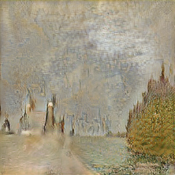

# Monet Studio · 多模型图像风格迁移平台

**AI-based style transfer for Monet-stylized images** — 基于无配对图像翻译的毕业设计，比较自然照片与莫奈画作之间的双向转换，并提供 Flask Web 界面。

## 项目做了什么

- 在同一界面集成 **CycleGAN、CUT、CycleGAN-Turbo、UNSB** 四种模型，支持 `Monet → Real` 与 `Real → Monet` 两个方向。
- 实现多图上传、逐图切换、模型选择、原图/结果预览、下载和会话内历史记录。
- 在 PyTorch 模型实现中探索 LPIPS 感知损失、DINO 结构约束及 U-Net 生成器；以 FID、DINO 结构相似度与推理时间比较模型的取舍。
- 保留模型训练/推理源码与原始依赖快照；训练权重独立分发，不放入 Git 历史。

技术栈：**Python · PyTorch · Flask · JavaScript/jQuery · Diffusers · Transformers · PEFT/LoRA**。

## 原实验样例

以下图片来自毕业设计原实验材料，并非本次整理重新生成。

| 方向 / 输入 | CycleGAN | CUT | CycleGAN-Turbo | UNSB |
| --- | --- | --- | --- | --- |
| 照片 → 莫奈<br> |  |  |  |  |
| 莫奈 → 照片<br> |  |  |  |  |

## 快速开始

建议使用 Python 3.10 与 NVIDIA CUDA 环境。先安装与机器匹配的 PyTorch / TorchVision；原实验使用 PyTorch 2.0.1 + CUDA 11.8 与 TorchVision 0.15.2。

```powershell
conda create -n monet-studio python=3.10 -y
conda activate monet-studio
pip install torch==2.0.1 torchvision==0.15.2 --index-url https://download.pytorch.org/whl/cu118
pip install -r requirements.txt
```

需要 CycleGAN-Turbo 时，再安装其依赖：

```powershell
pip install -r requirements-turbo.txt
```

按 [MODELS.md](MODELS.md) 放置训练权重，然后从仓库目录启动：

```powershell
python check_setup.py --model cyclegan
python app.py
```

打开 **http://127.0.0.1:5000**，上传图片并选择已配置权重的模型。界面默认选择 CycleGAN-Turbo，请根据实际安装情况切换。

已有训练权重目录时可直接指定，避免复制大文件：

```powershell
$env:MONET_MODEL_ROOT = 'D:\path\to\models'
python check_setup.py --model cyclegan
python app.py
```

`environment.yaml` 是原开发环境的完整历史快照，含训练和辅助工具；上面的依赖文件是整理后的推理入口，不代表在所有平台上均已完成全新环境安装验证。UNSB/Turbo 可能下载额外基础模型；Turbo 的上游代码含 CUDA 调用，不能据应用层的 device 判断推断其支持 CPU。

## 原实验结果

| 模型 | 单图推理 / s | 莫奈→照片 FID ↓ | DINO ↑ | 照片→莫奈 FID ↓ | DINO ↑ |
| --- | ---: | ---: | ---: | ---: | ---: |
| CycleGAN | 0.01 | 118.42 | **0.7783** | 61.34 | **0.7290** |
| CUT | 0.01 | 123.60 | 0.6161 | 68.72 | 0.4738 |
| UNSB | 0.07 | 112.76 | 0.6022 | **57.55** | 0.4784 |
| CycleGAN-Turbo | 0.13 | **103.43** | 0.2500 | 58.71 | 0.1879 |

来源：毕业设计报告 Chapter 4 的模型对比表，原实验硬件为 RTX 4090。数值为历史实验记录，本次整理没有重新跑完整评测；表中耗时不能当作包含模型加载和上传的 Web 请求延迟。详见 [EXPERIMENTS.md](EXPERIMENTS.md) 与 [CSV](experiment_results.csv)。

## 文件导航

| 文件/目录 | 作用 |
| --- | --- |
| `app.py` | Flask 路由、模型适配与图像转换 |
| `templates/`、`static/` | Web 界面与交互 |
| `src/cyclegan/`、`src/cut/` | GAN / 对比学习训练和推理 |
| `src/cyclegan_turbo/` | 单步扩散与 LoRA 适配 |
| `src/unsb/` | 薛定谔桥翻译、感知/结构约束实验 |
| `models/` | 权重说明；大文件需单独获取 |
| `dataset(sample_input_and_output)/` | 早期提交保留的输入/输出示例，并非完整训练集 |
| `check_setup.py` | 依赖、CUDA 与权重路径检查 |
| `test_app.py` | 不运行神经网络的 Web 接口回归测试 |

## 验证与边界

```powershell
python -m unittest test_app -v
```

当前是本地单用户研究原型：历史记录保存在内存中，每次推理重新加载模型。四个上游工程存在同名模块，因此应用按顺序处理请求，避免并发切换冲突；请直接使用 `python app.py`。不包含多用户鉴权或生产任务队列。测试及已知限制记录在 [VALIDATION.md](VALIDATION.md)。

## 来源与贡献

四种基础模型来自各自的开源研究实现，本项目的工作重点是任务适配、实验比较、局部模型改动与 Web 集成。不能把基础模型架构描述为从零原创。详见 [CONTRIBUTIONS.md](CONTRIBUTIONS.md) 和 [THIRD_PARTY_NOTICES.md](THIRD_PARTY_NOTICES.md)。各子目录保留原许可；本次整理没有为整个混合仓库重新授予统一许可证。
